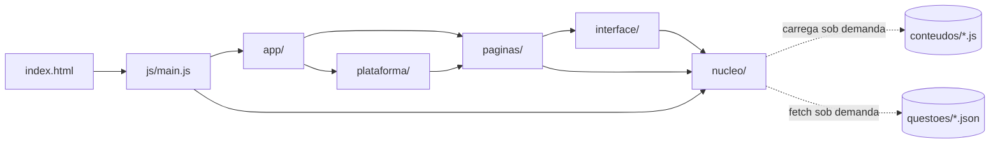
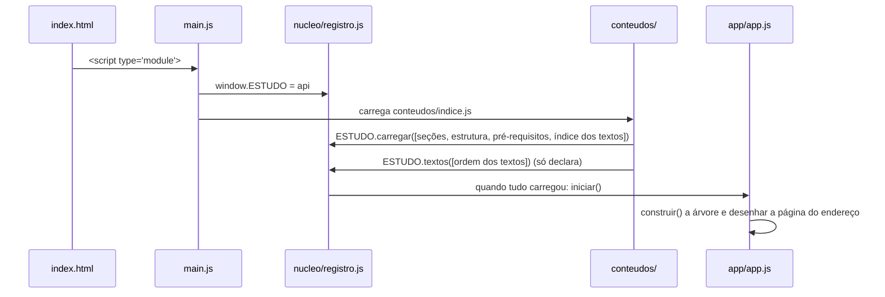

# Arquitetura

O Papiro é um site estático: **HTML, CSS e JavaScript em módulos ES**, sem framework, sem build e sem servidor próprio. Tudo o que muda em tempo de execução (progresso, respostas, horas) fica no navegador; o que é compartilhado entre as duas pessoas (ranking e cópia do progresso) usa o banco do Artefato do claude.ai.

Este documento explica **como o código está organizado** e **por quê**.

---

## Visão geral



- **`index.html`** só tem a marcação fixa (menu lateral, folha de leitura) e carrega `js/main.js`. É um **fragmento**, sem `<!doctype>`: o artefato o embrulha numa página completa.
- **`css/`** tem um arquivo por responsabilidade (tokens, layout, árvore, componentes, páginas, blocos, estudo, plataforma, responsivo).
- **`js/`** tem o motor, dividido em **cinco camadas**.
- **`conteudos/`** tem os dados do caderno, em scripts clássicos que chamam o objeto global `ESTUDO`.

---

## As camadas de `js/`

```
js/
  main.js        Ponto de entrada: expõe window.ESTUDO, carrega o índice e inicia a aplicação
  nucleo/        Dados e regras, sem desenhar páginas
  interface/     Peças de tela reutilizadas
  paginas/       Uma tela (ou família de telas) por arquivo
  plataforma/    Tudo o que depende do Artefato do claude.ai
  app/           Roteamento, menu lateral e eventos: junta as camadas
```

### Regra de dependência

Cada camada **só importa da própria camada ou das camadas abaixo**:

```
nucleo  →  interface  →  paginas  →  plataforma  →  app  →  main.js
(base)                                                      (topo)
```

Isso mantém o núcleo testável e independente da tela, e impede ciclos. A regra é verificada automaticamente em [`testes/arquitetura.spec.js`](../testes/arquitetura.spec.js), que também proíbe **ciclos de importação**. Se precisar de algo de uma camada acima, a peça provavelmente está no lugar errado: mova-a para baixo (foi o que aconteceu com `indiceDaCorreta`, que saiu de `interface/blocos.js` para `nucleo/util.js`).

### Módulos por camada

**`nucleo/`**: dados, estado e regras.

| Módulo | Papel |
|---|---|
| `util.js` | Funções puras (`esc`, `norm`, `slug`), chaves e acesso ao `localStorage`, `indiceDaCorreta`. |
| `estado.js` | Estado compartilhado: avisos de carregamento, assuntos estudados, sumário aberto, página atual, `aguardar()` da carga sob demanda. |
| `registro.js` | API `window.ESTUDO` usada por `conteudos/*.js` e a injeção de scripts. |
| `modelo.js` | Monta a árvore Seção → Conteúdo → Matéria → Assunto; contagens, progresso, pré-requisitos. |
| `carga.js` | Baixa os textos de um conteúdo só quando são necessários. |
| `provas.js` | Lê as questões de provas (JSON) com `fetch`, sob demanda. |
| `banco.js` | Banco de questões (autorais + provas), respostas, listas e simulados. |

**`interface/`**: peças de tela sem estado próprio.

| Módulo | Papel |
|---|---|
| `texto.js` | Mini-marcação (`**negrito**`, listas, fórmulas). |
| `blocos.js` | Um desenhista de HTML por tipo de bloco (texto, tabela, questão, python…). |
| `componentes.js` | Cabeçalhos, chips, barras, números, "Carregando…". |
| `dialogo.js` | Confirmação dentro da página (`confirm()` não funciona no artefato). |

**`paginas/`**: telas.

| Módulo | Papel |
|---|---|
| `vistas.js` | Início, seção, conteúdo, matéria e assunto. |
| `vistas-questoes.js` | Banco de questões, listas e simulados, com suas ações. |
| `plano.js` | Plano de estudos. |
| `horas.js` | Cronômetro do menu e página de horas. |

**`plataforma/`**: recursos do artefato, que se escondem quando não há artefato.

| Módulo | Papel |
|---|---|
| `plataforma.js` | Acesso único à plataforma (conta, banco compartilhado, Claude); tudo `null` fora do artefato. |
| `claude.js` | Mensagens de erro e leitura de anexos para assistente e redação. |
| `rank.js` | Ranking: grava só os números da própria pessoa. |
| `perfil.js` | Perfil, apelido, foto e cópia do progresso na nuvem. |
| `assistente.js` | Chat de dúvidas, com ferramenta que busca questões no banco. |
| `redacao.js` | Correção de redação por texto ou foto. |

**`app/`**: a aplicação.

| Módulo | Papel |
|---|---|
| `app.js` | Lê o endereço (`#`), escolhe a vista, desenha e redesenha quando a carga termina. |
| `rotas.js` | Tabela das páginas especiais (`#plano`, `#questoes`…). |
| `sumario.js` | Menu lateral: navegação, árvore e busca. |
| `eventos.js` | Cliques, teclado, formulários, flashcards e questões. |

---

## Como a página inicia



1. `main.js` expõe `window.ESTUDO` e carrega `conteudos/indice.js`.
2. O índice carrega **só o que é leve**: seções, estrutura, pré-requisitos e `conteudos/indice-textos.js` (gerado), que diz quais assuntos têm texto e o resumo de cada um.
3. `app.js` monta a árvore e desenha a página pedida no endereço.

---

## Carga sob demanda

O caderno **não baixa os textos na abertura**. Detalhes e motivos em [docs/decisoes/0001-carga-sob-demanda.md](decisoes/0001-carga-sob-demanda.md).

- **Textos** (`nucleo/carga.js`): ao abrir um assunto, a vista chama `aguardar(carregarTextos(caminho))` e desenha "Carregando o texto…". `carga.js` baixa **todos os arquivos ligados àquele conteúdo**, na ordem de `conteudos/indice.js`, porque o id das questões autorais (`caminho#ordem`) depende da ordem dos blocos. Quando terminam, o `app.js` redesenha a página.
- **Questões de provas** (`nucleo/provas.js`): `questoes/indice.json` é lido na primeira vez que o banco abre; os **baldes** (`questoes/<conteudo>/<banca>-<balde>.json`) só chegam quando o conteúdo é escolhido ou quando uma lista ou simulado precisa de uma questão específica.
- **Busca**: procura nos títulos na hora; na primeira busca, baixa os textos para procurar também dentro deles.

Quem carrega guarda o resultado (inclusive falhas), então uma página nunca fica pedindo a mesma coisa em laço.

---

## Rotas

O endereço depois do `#` define a página:

| Endereço | Página |
|---|---|
| `#` | Início |
| `#nucleo--matematica--aritmetica--regra-de-tres` | Seção, conteúdo, matéria ou assunto (o caminho com `--`) |
| `#plano` | Plano de estudos |
| `#questoes`, `#questoes--<caminho do assunto>` | Banco de questões (o segundo já filtra o assunto) |
| `#listas`, `#listas--<id>` | Listas de questões |
| `#simulados`, `#simulados--fazer`, `#simulados--resultado--<id>` | Simulados |
| `#horas` | Horas de estudo |
| `#rank`, `#assistente`, `#redacao`, `#perfil` | Recursos do artefato (somem do menu fora dele) |

---

## Estado e persistência

Tudo fica no `localStorage` do navegador, com prefixo `papiro.` (diferente do `dojo.` do projeto irmão):

| Chave | Conteúdo |
|---|---|
| `papiro.estudados` | Assuntos marcados como estudados |
| `papiro.respostas` | Acertos e erros por questão (pelo id da questão) |
| `papiro.listas`, `papiro.simulados` | Listas de questões e simulados |
| `papiro.horas` | Tempo de estudo por dia e matéria |
| `papiro.plano` | Matérias do plano e sua ordem |
| `papiro.perfil`, `papiro.rankUltimo`, `papiro.backupEm` | Perfil, último envio ao ranking, última cópia na nuvem |
| `papiro.assistente`, `papiro.redacoes` | Conversa e redações |
| `papiro.ultimo`, `papiro.abertos` | Último assunto aberto e nós abertos do sumário |

Para passar o progresso de um aparelho a outro: **"Salvar agora"** no perfil (cópia na nuvem, no artefato) e **"Restaurar"** no outro.

---

## Artefato do claude.ai

O Papiro publicado declara três capacidades:

- **`user`**: identidade da pessoa (perfil e ranking), com nome e foto.
- **`db`**: banco compartilhado, com regras em que cada pessoa grava só o próprio documento em `rank/<id>`.
- **`sample`**: chamadas ao Claude (assistente e redação), com imagens.

Toda chamada passa por `plataforma/plataforma.js`. Fora do artefato (por exemplo, no Live Server), essas capacidades são `null` e os itens do menu correspondentes **somem**. No artefato, `confirm()`, `alert()` e `prompt()` não funcionam: use `confirmar()` de `interface/dialogo.js`.

---

## Convenções de código

- Módulos ES (`import`/`export`), `const`/`let`, funções pequenas com um papel só, **nomes em português**.
- Os arquivos de `conteudos/` **não** são módulos: chamam o global `ESTUDO.*`.
- CSS com uma declaração por linha; cores e fontes só pelas variáveis de `css/base.css`; evitar `style="..."` no HTML gerado, exceto para valores calculados.
- Um bug encontrado vira um teste em `testes/` antes da correção.
