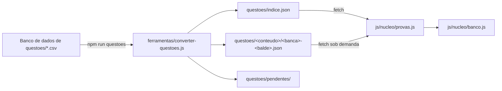

# Questões de provas

Além das questões autorais escritas nos assuntos, o banco recebe **questões de provas anteriores** a partir de arquivos CSV. Elas são convertidas em JSON e lidas **sob demanda**.

> As questões têm **direitos autorais das bancas**. Por isso `questoes/` e a pasta dos CSVs ficam **fora do git** (veja o `.gitignore`) e só vão para o artefato na publicação. Outro computador não as recebe pelo git.

---

## Fluxo



1. Os CSVs ficam em `Banco de dados de questoes/`, com o nome `questoes<Matéria><Banca>.csv` (por exemplo, `questoesAdministrativoCespe.csv`).
2. `npm run questoes` roda o conversor, que **apaga e refaz** `questoes/`.
3. O caderno lê `questoes/indice.json` quando o banco abre e baixa os baldes quando um conteúdo é escolhido.

---

## O que o conversor faz

- **Mapeia** o nome do arquivo para o conteúdo do caderno (tabela `MATERIAS` no script). Matéria fora do escopo é ignorada.
- **Limpa o enunciado**: separa o comando grudado ao texto e junta linhas quebradas no meio da frase.
- **Lê as alternativas**: `a) … | b) …` vira lista; `Errado | Certo` vira **Certo/Errado**.
- **Descarta** questões repetidas e as que têm gabarito que não bate com as alternativas.
- **Marca** com aviso `conferir` as que citam a **Lei 8.666/1993** (revogada pela Lei 14.133/2021).
- **Separa** em `questoes/pendentes/` as de Português que dependem de um **texto-base** que não veio no CSV. Elas não aparecem no caderno; um texto inventado daria gabarito errado.

---

## Formato

`questoes/indice.json`:

```json
{
  "versao": 1,
  "baldes": 16,
  "conteudos": {
    "nucleo/direito-administrativo": {
      "Cebraspe": { "chave": "cebraspe", "total": 6112, "anos": [1995, 2018], "revogadas": 288, "baldes": ["0", "1", "…"] }
    }
  }
}
```

Cada balde é uma lista de questões:

```json
{ "id": "p:nucleo/direito-administrativo:cebraspe:009819fa15ad", "ano": 2018,
  "enunciado": "…", "alternativas": ["…"], "correta": 1, "conferir": "…" }
```

### Id estável

`p:<conteudo>:<banca>:<hash de 12 caracteres>`. O hash vem do **texto da questão** (enunciado e alternativas, ignorando espaços e quebras de linha), então **gerar tudo de novo não muda nenhum id** e o histórico de respostas se mantém. O primeiro caractere do hash escolhe o **balde** (16 por banca): com o id, a página sabe qual arquivo buscar.

> **Nunca** mude a regra do id sem migrar as respostas gravadas (`papiro.respostas`).

---

## Números atuais

| Conteúdo | Cebraspe | FCC |
|---|---|---|
| Direito Administrativo | 6.112 | 4.356 |
| Direito Constitucional | 4.983 | 3.644 |
| Português | 382 | — |

São questões até **2018**, sem órgão, cargo nem assunto: filtram por **conteúdo e banca**, não por assunto. Português tem ainda **8.576 pendentes** de texto-base.

---

## Nos testes

A suíte não depende da pasta real: [`testes/dados/questoes/`](../testes/dados/questoes/) tem três questões **fictícias** no mesmo formato, servidas no lugar de `questoes/` (veja [testes.md](testes.md)).
